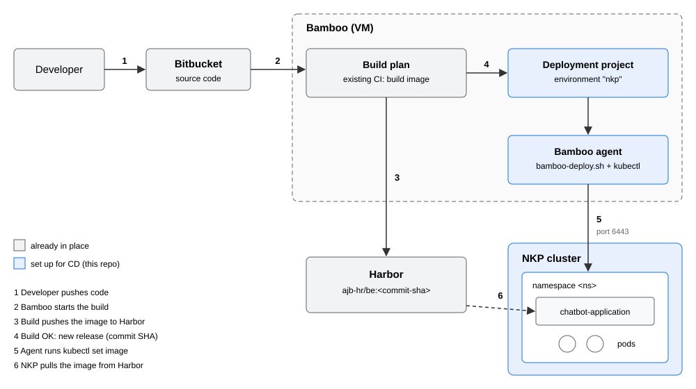

# Bamboo CD to NKP

This repo deploys an application image from Harbor to an NKP cluster, using a
Bamboo deployment project.

The build side (CI) already exists: a Bamboo build plan builds the image and pushes it
to Harbor, tagged with the commit SHA. This repo only adds the deployment side (CD).



1. A developer pushes code to Bitbucket.
2. Bamboo starts the existing build plan.
3. The build pushes the image to Harbor, for example `ajb-hr/be:<commit-sha>`.
4. When the build succeeds, Bamboo creates a release. We name the release after the
   commit SHA, which is how Bamboo knows which image to deploy.
5. The deployment project runs `scripts/bamboo-deploy.sh` on a Bamboo agent. The
   script runs `kubectl set image` against the NKP cluster and waits until the new
   pods are ready. If they don't become ready, it rolls back and the deployment fails.
6. NKP pulls the image from Harbor and starts the new pods.

To roll back, deploy an older release from Bamboo.

## How Bamboo deploys

Bamboo has two kinds of projects:

- A **build plan** (CI) checks out the code, builds the image, and pushes it. The
  customer already has this.
- A **deployment project** (CD) is linked to one build plan. Every successful build
  can become a **release**, which is a named snapshot of that build. You **deploy a
  release to an environment** (here, `nkp`). The environment runs its tasks, which
  here is a single Script task, on an agent.

The script only gets the **release name** from Bamboo (`bamboo_deploy_release`), so
the release name has to tell it which image tag to deploy. There are two ways,
selected with the variable `tag_from`:

| `tag_from` | CI tags images with | Release name | Tag deployed |
|---|---|---|---|
| `sha` (default) | the commit SHA | `${bamboo.planRepository.revision}-${bamboo.buildNumber}`, e.g. `1e421cc…-42` | `1e421cc…` (optionally shortened or prefixed) |
| `release` | a version, e.g. `1.4.2` | the tag itself, e.g. `1.4.2` | `1.4.2` |

With `tag_from=release`, you name the release when you create it (Bamboo suggests
the next name, which you can edit), or the build plan provides it (see
[Version tags from CI](#version-tags-from-ci)). Either way, rollback is the same:
deploy an older release.

## Files

| File | Used by | Purpose |
|---|---|---|
| `nkp/setup.sh`, `nkp/rbac.yaml` | NKP admin, once | Creates the namespace, a service account for Bamboo, the Harbor pull secret, and a kubeconfig for Bamboo |
| `k8s/deployment.yaml`, `k8s/service.yaml` | `scripts/deploy-app.sh` | The app `chatbot-application` |
| `k8s/ingress.yaml` | You, optional | Exposes the app on NKP's Traefik |
| `scripts/deploy-app.sh` | Once | Applies the Deployment and Service the first time |
| `scripts/bamboo-deploy.sh` | Bamboo, every deployment | Pasted into the Bamboo Script task |
| `Makefile` | You, optional | Shortcuts for the same commands, if `make` is installed |

## Information to collect from the customer

Fill this in at deployment time:

| Item | Example | Value |
|---|---|---|
| Namespace on NKP | `hr-chatbot` | |
| Image repository in Harbor | `harbor-uat.example.com/ajb-hr/be` | |
| Tag format: commit SHA (full, 7 or 8 chars, prefix?) or a version like `1.4.2` | full SHA | |
| Is every tag unique, or are tags like `latest` reused? | unique | |
| Container port | `8080` | |
| Environment variables or secrets the app needs | `DB_URL`, `API_KEY` | |
| Harbor robot account (pull) for NKP | `robot$ajb-hr+nkp` | |
| Does Harbor use a private CA? Do the NKP nodes trust it? | yes / yes | |
| Bamboo agent that runs deployments; is `kubectl` installed? | local agent on the Bamboo VM | |
| NKP API address, reachable from that agent | `https://10.0.0.10:6443` | |
| Hostname for the app (optional) | `hr-be.apps.example.com` | |

## Steps

### 1. Prepare NKP (NKP admin, once)

You need `bash`, `kubectl` and `unzip`. `make` is not needed: every command below
calls the scripts directly. (If you have `make`, the `Makefile` offers the same steps
as shortcuts.)

```bash
unzip bamboo-cd-demo.zip
cd bamboo-cd-demo
export KUBECONFIG=<nkp-admin-kubeconfig>
export HARBOR_HOST=<harbor> HARBOR_USERNAME='<robot-account>' HARBOR_PASSWORD='<robot-token>'
NAMESPACE=<namespace> bash nkp/setup.sh
```

This creates:
- the namespace
- service account `bamboo-deployer`, which can only manage apps in this namespace
- pull secret `harbor-pull`
- the file `bamboo-nkp.kubeconfig`, which Bamboo will use

If the app needs environment variables, put them in the secret `chatbot-application-env`:
```bash
kubectl -n <namespace> create secret generic chatbot-application-env --from-env-file=app.env
```

### 2. Deploy the app the first time (once)

From here on, use the kubeconfig Bamboo will use. This also checks that its
permissions are right.
```bash
export KUBECONFIG=$PWD/bamboo-nkp.kubeconfig
NAMESPACE=<namespace> IMAGE=<image-repo>:<current-tag> PORT=<port> bash scripts/deploy-app.sh
```

This applies `k8s/deployment.yaml` (2 pods, rolling update) and `k8s/service.yaml`.

To expose the app with a hostname (optional):
```bash
sed 's/HOST_PLACEHOLDER/<hostname>/' k8s/ingress.yaml | kubectl -n <namespace> apply -f -
```

### 3. Test the deploy script without Bamboo

This sets the same variables Bamboo sets and runs the same script (with
`KUBECONFIG` still set from step 2):
```bash
bamboo_deploy_release=<commit-sha>-1 bamboo_image_repo=<image-repo> \
bamboo_namespace=<namespace> bamboo_tag_length=0 \
  sh scripts/bamboo-deploy.sh
kubectl -n <namespace> get deploy,pods,svc,ingress -o wide
kubectl -n <namespace> rollout history deployment/chatbot-application
```

### 4. Configure Bamboo (in the UI)

1. **Create → Create deployment project.** Link it to the existing build plan of the app.
2. **Release versioning** (Edit project → Release versioning). Set the name to:
   ```
   ${bamboo.planRepository.revision}-${bamboo.buildNumber}
   ```
   Releases are then named like `a1b2c3d…-42`: the commit SHA, then the build number.
3. **Add environment** `nkp`. Under *Set up tasks*, keep *Clean working directory* and
   add a **Script** task:
   - Interpreter: Shell
   - Script location: Inline
   - Script body: paste the whole of `scripts/bamboo-deploy.sh`
4. **Variables** (environment `nkp` → Variables):

   | Variable | Value |
   |---|---|
   | `nkp_kubeconfig_secret` | output of `base64 -w0 bamboo-nkp.kubeconfig` (hidden in logs because the name contains `secret`) |
   | `image_repo` | image repository, e.g. `harbor-uat.example.com/ajb-hr/be` |
   | `namespace` | the namespace |
   | `app` | `chatbot-application` |
   | `tag_from` | `sha` or `release` (see [How Bamboo deploys](#how-bamboo-deploys)) |
   | `tag_length` | `tag_from=sha`: `0` for the full SHA, or `7` / `8` |
   | `tag_prefix` | `tag_from=sha`: `none`, or the text before the SHA in the tag |
   | `image_tag` | `none` (set a tag here only to force a specific image) |
   | `rollout_timeout` | `300s` |
5. **Agents assignment.** Pick the agent that has `kubectl`.
6. **Triggers.** Add *After successful build plan* to deploy automatically. Without
   it, you deploy by clicking *Deploy*.

### 5. Test together

1. Run the build plan, or push a commit.
2. A new release appears in the deployment project and is deployed to `nkp`.
3. Check the pods: `kubectl -n <namespace> get pods`. They should run the new tag.
4. Rollback: environment `nkp` → *Deploy* → choose an older release.
5. Failure test: set `image_tag` to `does-not-exist` and deploy. The script rolls
   back and the deployment shows as failed. Set `image_tag` back to `none`.

## Demo with nginx from Docker Hub

Use this to show the whole flow before you know the customer's image. Docker Hub tags
nginx by version, so use `tag_from=release` and name each release after an nginx
tag. The NKP nodes need internet access to Docker Hub. Anonymous pulls are
rate-limited, which is fine for a demo.

1. Set up NKP without Harbor, leaving the `HARBOR_*` variables unset. The Deployment
   refers to the pull secret `harbor-pull`, which won't exist. Kubernetes only logs a
   warning for that, and public images still pull.
   ```bash
   export KUBECONFIG=<nkp-admin-kubeconfig>
   NAMESPACE=nginx-demo bash nkp/setup.sh
   ```
2. Deploy the first version. nginx listens on port 80:
   ```bash
   export KUBECONFIG=$PWD/bamboo-nkp.kubeconfig
   NAMESPACE=nginx-demo IMAGE=nginx:1.26 PORT=80 bash scripts/deploy-app.sh
   ```
3. Try a deployment without Bamboo:
   ```bash
   bamboo_deploy_release=1.27 bamboo_image_repo=nginx \
   bamboo_namespace=nginx-demo bamboo_tag_from=release \
     sh scripts/bamboo-deploy.sh
   kubectl -n nginx-demo get pods -o wide
   ```
4. In Bamboo, a deployment project must be linked to a build plan. If you don't have
   one, create a plan with a single Script task (`echo build`) and run it once.
   Create the deployment project as in [step 4](#4-configure-bamboo-in-the-ui), with
   `image_repo` = `nginx`, `namespace` = `nginx-demo`, and `tag_from` = `release`.
   Skip the release-versioning step and the trigger.
5. Demo:
   - **Create release** from the plan's build result, named `1.26`. Deploy it to `nkp`.
   - Create release `1.27` and deploy it. The pods roll to nginx 1.27.
   - **Rollback:** deploy release `1.26` again.
   - **Failure:** create release `9.99` and deploy it. The image doesn't exist, so
     the script rolls back and Bamboo shows the deployment as failed.

Check the running version with
`kubectl -n nginx-demo get pods -o jsonpath='{..image}'`.

## Version tags from CI

If the customer's build plan tags images with a version instead of the SHA, the
build has to tell Bamboo which tag it pushed. At the end of the build plan, add an
**Inject Bamboo variables** task that reads a file containing `image_tag=<tag>`, with
scope *Result*. Then set the deployment project's release naming to
`${bamboo.inject.image_tag}` and `tag_from` to `release`. Check that the customer's
Bamboo version accepts injected variables in release naming. If it doesn't, create
the releases by hand with the tag as the name.

Tags that are reused, such as `latest`, don't work with this script. Deploying the
same tag again changes nothing, so no new pods start, and rollback can't tell versions
apart. Ask the customer for unique tags.

## Harbor certificate

If Harbor uses a certificate from a private CA, only one place has to trust it: **the
NKP nodes**, because they pull the image.

- The Bamboo agent never connects to Harbor during deployment, so it doesn't need
  the CA.
- `kubectl` connects to the NKP API, and the kubeconfig from step 1 already contains
  the NKP CA.

**Check whether the nodes trust Harbor (NKP admin):**
```bash
kubectl -n <namespace> run harbor-test --restart=Never \
  --image=<image-repo>:<existing-tag> --overrides='{"spec":{"imagePullSecrets":[{"name":"harbor-pull"}]}}'
kubectl -n <namespace> get pod harbor-test      # Running or Completed = OK
kubectl -n <namespace> describe pod harbor-test | grep -i x509   # x509 error = CA not trusted
kubectl -n <namespace> delete pod harbor-test
```

**If you get an x509 error**, the NKP admin has to add the Harbor CA to the cluster's
registry configuration. That is the permanent fix, and it survives node replacement.
For a quick test in a lab you can add it by hand on each node:
```bash
mkdir -p /etc/containerd/certs.d/<harbor>
cp harbor-ca.crt /etc/containerd/certs.d/<harbor>/ca.crt
cat > /etc/containerd/certs.d/<harbor>/hosts.toml <<EOF
server = "https://<harbor>"
[host."https://<harbor>"]
  ca = "/etc/containerd/certs.d/<harbor>/ca.crt"
EOF
```

## Troubleshooting

| Problem | Fix |
|---|---|
| `kubectl: not found` | Install kubectl in `/usr/local/bin` on the agent. Bamboo running under systemd has a short PATH. |
| `Unable to connect to the server` | The agent can't reach the NKP API on port 6443 (firewall or proxy), or the kubeconfig variable is incomplete. Copy the `base64 -w0` output again. |
| `deployments.apps "chatbot-application" not found` | Step 2 wasn't run, or the `namespace` variable doesn't match it. |
| `forbidden` | Step 1 was run for a different namespace. |
| `ImagePullBackOff` with `not found` | The tag doesn't exist in the registry. With `tag_from=sha`: check `tag_length` and `tag_prefix`, and that the release name starts with the commit SHA. With `tag_from=release`: the release name must be exactly the tag. |
| `ImagePullBackOff` with `x509` | The NKP nodes don't trust the Harbor CA. See [Harbor certificate](#harbor-certificate). |
| `ImagePullBackOff` with `unauthorized` | The pull secret is wrong. Run step 1 again with the right robot account. |
| Pods restart (`CrashLoopBackOff`) | Check `kubectl logs`: usually missing environment variables. |

## Cleanup

```bash
export KUBECONFIG=<nkp-admin-kubeconfig>
kubectl delete namespace <namespace>
```
Then delete the deployment project in Bamboo.
